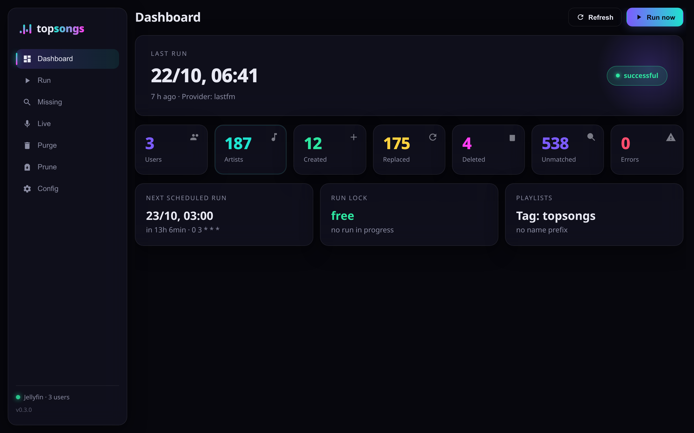
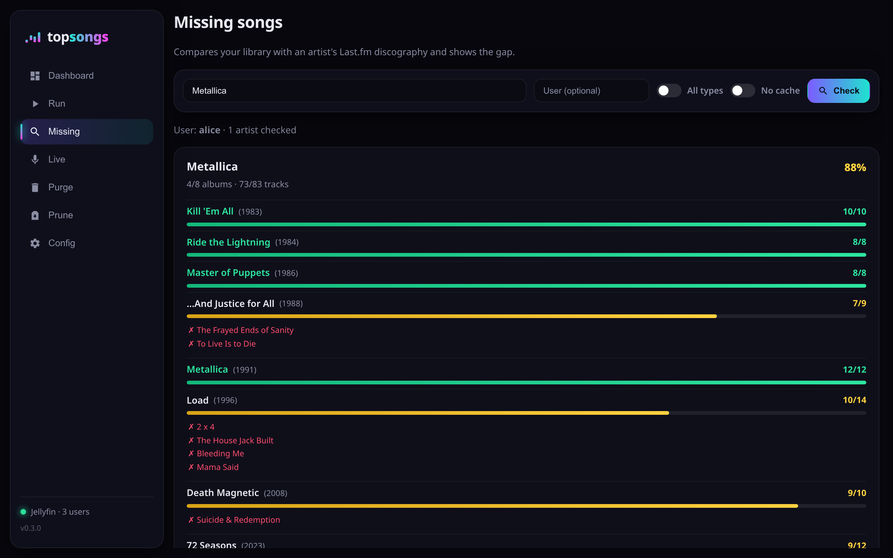
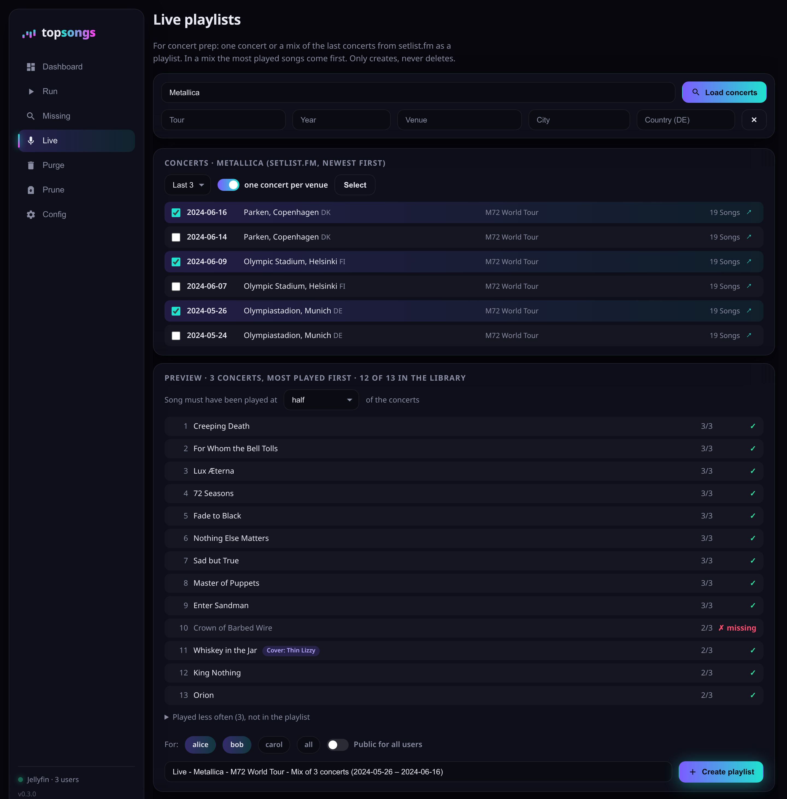

<div align="center">


# topsongs for Jellyfin

### Per-artist "greatest hits" playlists for your Jellyfin library — built automatically, personalized per user, and refreshed on every scheduled run.

[](LICENSE)
[](https://www.python.org/)

</div>

A Jellyfin music library knows your artists but has no "best of this artist" playlists, and Jellyfin will not generate them for you. `topsongs` fills that gap. For every artist you own enough tracks of, it builds a playlist named after the artist and ordered by Last.fm's crowd-sourced popularity, then nudges that order toward what each Jellyfin user actually plays. It runs unattended on a nightly schedule; each run re-reads your library and refreshes every playlist to match — no manual curation, no playlist housekeeping.

## Highlights

- **Non-destructive.** `topsongs` only works on playlists: it creates, tags and deletes its own, and renames them only when you prune. It never downloads music or changes tracks, their metadata, files, or albums — your library is left exactly as it was.
- **Scoped, predictable cleanup.** It marks every playlist it creates with a Jellyfin tag and only ever replaces or deletes tagged ones. Everything else in Jellyfin — including playlists you made by hand, even under the same name — is invisible to it.
- **Safe to preview.** `DRY_RUN=true` runs a full planning pass and logs every action it would take, while writing nothing to Jellyfin.
- **Failure isolation.** One artist's failure does not abort the rest of the run, and the failed artist's existing playlist is kept — a transient Last.fm hiccup never costs you data.
- **Personalized per user.** Each Jellyfin user gets their own playlists, reordered by their own play counts and favorites — not one shared ranking.
- **Conservative matching.** Track titles are matched exactly first, then by a normalized form (lowercased, accent-folded, remaster/live/feat. tags stripped). It is deliberately not fuzzy, so it does not invent matches — and it is not a recommendation engine.
- **Container-first, self-hostable.** Ships as a Docker image with a Compose example and a nightly cron. It is also a plain Python CLI for development and one-off runs.
- **Concert prep.** On request, [live playlists](#live-playlists) turn a concert's setlist from setlist.fm, or a mix of an artist's last concerts, into a playlist from your library — most-played songs first.
- **Web dashboard.** An optional built-in UI drives every action — trigger a run with a live log stream, put together live playlists, run the missing-songs report, and preview/execute purge and prune — alongside the nightly cron in the same container.

---

## Quick start

You need a Jellyfin server (10.9 or newer) with a music library, a Jellyfin API key, and a Last.fm API key. [Creating the API keys](#creating-api-keys) is covered below.

The recommended setup is Docker Compose from the `appdata/` directory:

```bash
cd appdata
cp .env.example .env
# edit .env — set JELLYFIN_URL, JELLYFIN_API_KEY, LASTFM_API_KEY
docker compose up -d --build
```

The container stays running and starts cron in the foreground. It runs on `CRON_SCHEDULE` (daily at 03:00 by default). To trigger a run immediately at startup, set `RUN_ON_STARTUP=true`.

To run a refresh now, without waiting for cron:

```bash
./run-topsongs
```

To watch the logs:

```bash
docker compose logs -f app
```

> [!TIP]
> Want to see what a run would do before it touches Jellyfin? Run `./run-topsongs --dry-run` — every planned action is logged and nothing is written. Set `DRY_RUN=true` in `.env` to make that the default for every run.

## Web dashboard

<div align="center">

&nbsp;

<br>
<sub><em>The dashboard (left) and the missing-songs report (right).</em></sub>
</div>

The container also serves a web dashboard on port `8080` (the `appdata/docker-compose.yml` example publishes it). Open `http://<host>:8080` and you get every topsongs action in one place:

- **Dashboard** — the last run's status and counts, the next scheduled run, the run-lock state, the tag that marks the playlists, and Jellyfin reachability at a glance.
- **Run** — trigger a playlist refresh (with an optional dry run) and watch the logs stream live; it is the same job cron runs nightly, and the run lock still prevents overlap.
- **Missing** — the [missing-songs gap report](#finding-missing-songs) rendered with per-album coverage bars.
- **Live** — put together a [live playlist](#live-playlists): pick concerts with autocompleted filters, preview the song order, then create it for one, several or all users, or as one public playlist. Shown when `SETLISTFM_API_KEY` is set.
- **Purge** and **Prune** — preview exactly what would be deleted, then execute behind a confirmation.
- **Config** — the effective settings of the running container (secrets are redacted).

It runs as a small FastAPI app started by the `topsongs-web` console script, in the same container as cron. The dashboard is unauthenticated by default, which is fine behind a reverse proxy or on a trusted network; set `TOPSONGS_WEB_TOKEN` to require that token (sent as a bearer token) on every API call. `TOPSONGS_WEB_HOST` and `TOPSONGS_WEB_PORT` change the bind address and port. The dashboard speaks English or German, following `TOPSONGS_LANGUAGE`.

> [!WARNING]
> The dashboard can delete playlists (purge/prune), create live playlists and trigger runs. Do not expose port `8080` to an untrusted network without setting `TOPSONGS_WEB_TOKEN` or putting an authenticating proxy in front of it.

For local development, install the web extra and launch it directly:

```bash
pip install -e '.[web]'
topsongs-web   # serves on 0.0.0.0:8080
```

## Personalized ranking

Playlists are built per Jellyfin user, so `topsongs` does not simply copy the Last.fm order. It also reads each user's own play counts and favorites from Jellyfin and lets them reorder the list, so songs a user actually listens to move higher.

`PERSONALIZATION_WEIGHT` controls how strongly personal listening counts:

| Value | Behavior |
| :---: | --- |
| `0.0` | Last.fm order, apart from the [new-release bonus](#new-releases). |
| `0.6` (default) | Personal taste leads; Last.fm decides where the user has little listening history. |
| `1.0` | Order driven almost entirely by the user's own play counts and favorites. |

When `APPEND_UNMATCHED_SONGS` is enabled and `PERSONALIZATION_WEIGHT` is above `0.0`, the appended local tracks are ordered by play count as well.

### New releases

Last.fm's top tracks and Jellyfin's play counts are both all-time totals, so a new album ranks low just because it has had little time to collect plays. `RECENCY_BONUS` adds a score bonus to a track released this year. The bonus fades to 2/3 for last year's releases and 1/3 for the year before, and older tracks get nothing. The release year is the track's year tag in Jellyfin; tracks without one get no bonus. Unset, empty or `0` means no bonus; `appdata/.env.example` sets `0.3`.

The bonus is on the same 0–1 scale as the blended score above. With `0.3`, the strongest tracks of a brand-new album reach the upper part of the playlist while the established hits stay on top. The bonus does not reach local tracks that Last.fm does not list, which stay in the appended block. Remastered reissues tagged with the reissue year are boosted like new releases.

## Configuration

All configuration is environment variables, loaded from `appdata/.env`. Copy `.env.example` to `.env` as shown in [Quick start](#quick-start), then edit it for your setup.

Example values:

```env
JELLYFIN_URL=http://jellyfin:8096
JELLYFIN_API_KEY=replace_me
LASTFM_API_KEY=replace_me
MIN_TRACKS_PER_ARTIST=10
MIN_TRACK_DURATION_SECONDS=60
STATE_DIR=./state
LOG_LEVEL=INFO
TOPSONGS_LANGUAGE=en
REQUEST_TIMEOUT_SECONDS=20
REQUEST_MAX_RETRIES=2
RETRY_BACKOFF_SECONDS=1.0
RUN_CONCURRENCY=1
MIN_REQUEST_INTERVAL=0
MAX_PROVIDER_TRACKS=200
PERSONALIZATION_WEIGHT=0.6
RECENCY_BONUS=0.3
APPEND_UNMATCHED_SONGS=true
DRY_RUN=false
ARTIST_ALLOWLIST=
ARTIST_DENYLIST=
USER_ALLOWLIST=
USER_DENYLIST=
LIBRARY_PATH_ALLOWLIST=
LIBRARY_PATH_DENYLIST=
PROJECT_ROOT=..
CRON_SCHEDULE=0 3 * * *
RUN_ON_STARTUP=false
SETLISTFM_API_KEY=
LIVE_PLAYLIST_PREFIX="Live - "
TOPSONGS_WEB_HOST=0.0.0.0
TOPSONGS_WEB_PORT=8080
TOPSONGS_WEB_TOKEN=
```

`JELLYFIN_URL`, `JELLYFIN_API_KEY`, and `LASTFM_API_KEY` are required; everything else has a working default.

Characters invalid in filenames (`/ \ : * ? " < > |`) are replaced with `_` in the artist part of a playlist name, so `AC/DC` becomes `AC_DC`.

### Full configuration reference

| Variable | Required | Default | Purpose |
| --- | :---: | --- | --- |
| `JELLYFIN_URL` | yes | none | Base URL for the Jellyfin server, for example `http://jellyfin:8096`. |
| `JELLYFIN_API_KEY` | yes | none | Jellyfin API key used to read users/items and create/delete playlists. |
| `LASTFM_API_KEY` | yes | none | Last.fm API key used to fetch artist top tracks. |
| `MIN_TRACKS_PER_ARTIST` | no | `10` | Artists must have more local tracks than this value to be processed. |
| `MIN_TRACK_DURATION_SECONDS` | no | `60` | Local tracks shorter than this are excluded from matching and playlists. Set to `0` to disable duration filtering. |
| `STATE_DIR` | no | `./state` | Directory for runtime files such as `last_run.txt` and the lockfile, relative to the working directory. |
| `LOG_LEVEL` | no | `INFO` | Python logging level. Raise to `DEBUG` for per-request and per-track detail. |
| `TOPSONGS_LANGUAGE` | no | `en` | Language of the command-line output and `--help`, the dashboard, and the description of new live playlists: `en` or `de`. Logs and `last_run.txt` stay English. |
| `REQUEST_TIMEOUT_SECONDS` | no | `20` | HTTP timeout for Jellyfin, Last.fm and setlist.fm requests. |
| `REQUEST_MAX_RETRIES` | no | `2` | Retry count for retryable network and server errors. |
| `RETRY_BACKOFF_SECONDS` | no | `1.0` | Base delay between retries. A server's `Retry-After` header, up to 10 seconds, takes precedence. |
| `RUN_CONCURRENCY` | no | `1` | Number of artists planned in parallel per user. `1` keeps the sequential behavior; higher values process more artists at once, which can shorten a run when Last.fm fetches dominate. Clamped to `1`–`16`. |
| `MIN_REQUEST_INTERVAL` | no | `0` | Minimum seconds between Last.fm requests, enforced across all threads. `0` disables throttling; raise it if Last.fm returns HTTP 429 under concurrency. |
| `MAX_PROVIDER_TRACKS` | no | `200` | Maximum Last.fm top tracks to fetch and consider per artist. |
| `PERSONALIZATION_WEIGHT` | no | `0.6` | How much each user's own Jellyfin listening reorders a playlist, from `0.0` (Last.fm order) to `1.0` (purely personal). Clamped to `0.0`–`1.0`. See [Personalized ranking](#personalized-ranking). |
| `RECENCY_BONUS` | no | empty | Score bonus for recent releases, fading out over three years; `0.3` is a good start. Empty, `0` or `0.0` means no bonus. Clamped to `0.0`–`1.0`. See [New releases](#new-releases). |
| `PLAYLIST_NAME_PREFIX` | no | empty | Optional prefix for the playlist names, for example `Top Songs - ` for `Top Songs - Powerwolf`. Only shapes the names; the tag marks the playlists. See [How topsongs recognizes its playlists](#how-topsongs-recognizes-its-playlists). |
| `PLAYLIST_MANAGED_TAG` | no | `topsongs` | The Jellyfin tag `topsongs` applies to every playlist it creates and recognizes them by. Must not be `topsongs-live`, the tag of the live playlists. |
| `APPEND_UNMATCHED_SONGS` | no | `true` | Whether local tracks missing from the provider top list are appended to the end of generated playlists, one entry per song. Set to `false` to keep playlists limited to provider matches. |
| `DRY_RUN` | no | `false` | Set to `true` to simulate a run without creating or deleting any playlists. All planned actions are logged but no changes are written to Jellyfin. |
| `ARTIST_ALLOWLIST` | no | empty | Comma-separated artist names to include. Empty means all artists. |
| `ARTIST_DENYLIST` | no | empty | Comma-separated artist names to exclude. |
| `USER_ALLOWLIST` | no | empty | Comma-separated Jellyfin user names to include. Empty means all enabled users. |
| `USER_DENYLIST` | no | empty | Comma-separated Jellyfin user names to exclude. |
| `LIBRARY_PATH_ALLOWLIST` | no | empty | Comma-separated Jellyfin `Path` prefixes to include, for example `/music`. |
| `LIBRARY_PATH_DENYLIST` | no | empty | Comma-separated Jellyfin `Path` prefixes to exclude. |
| `PROJECT_ROOT` | no | `..` | Docker build context used by `appdata/docker-compose.yml`. |
| `CRON_SCHEDULE` | no | `0 3 * * *` | Cron expression for scheduled container runs. The default runs daily at 03:00 in the container's local timezone. |
| `RUN_ON_STARTUP` | no | `false` | Set to `true` to run once when the container starts. |
| `TOPSONGS_WEB_HOST` | no | `0.0.0.0` | Bind address for the [web dashboard](#web-dashboard). |
| `TOPSONGS_WEB_PORT` | no | `8080` | Port for the web dashboard. |
| `TOPSONGS_WEB_TOKEN` | no | empty | When set, every dashboard API call must send this value as a bearer token. Empty leaves the dashboard open. |
| `SETLISTFM_API_KEY` | no | empty | setlist.fm API key for [live playlists](#live-playlists). Empty turns the feature off. |
| `LIVE_PLAYLIST_PREFIX` | no | `Live - ` | Prefix of the live playlists' names. Only shapes the names; the `topsongs-live` tag marks them. |

### How topsongs recognizes its playlists

Every playlist a run creates gets a Jellyfin tag, `PLAYLIST_MANAGED_TAG` (default `topsongs`). That tag, not the name, marks a playlist as managed: only tagged playlists are refreshed and eligible for cleanup, so a hand-made playlist that happens to share an artist name is left untouched. Live playlists carry their own tag, `topsongs-live`, and runs, purge and prune never touch them.

Playlist names are bare by default, just the artist like `Powerwolf`. `PLAYLIST_NAME_PREFIX` adds a prefix to every name:

```env
PLAYLIST_NAME_PREFIX="Top Songs - "
```

> [!NOTE]
> Versions before tags recognized the playlists by the `Top Songs - ` prefix alone. On upgrading, a user who has no tagged playlist yet gets their untagged playlists with the prefix (`PLAYLIST_NAME_PREFIX`, or `Top Songs - ` when unset) tagged once on the next run, so none are left behind. With the prefix unset, those playlists are then replaced by bare-named ones; set `PLAYLIST_NAME_PREFIX="Top Songs - "` to keep the old names.

### Allow and deny filters

Each of artist, user, and library-path has an allowlist and a denylist. Name matching is normalized; library-path matching compares against Jellyfin `Path` prefixes. An empty allowlist or denylist is valid and means "no filter".

```env
ARTIST_ALLOWLIST=Powerwolf,Nightwish
ARTIST_DENYLIST=Various Artists,Soundtrack
USER_ALLOWLIST=alice,bob
USER_DENYLIST=guest
LIBRARY_PATH_ALLOWLIST=/music
LIBRARY_PATH_DENYLIST=/music/podcasts,/music/audiobooks
```

### Creating API keys

- **Jellyfin:** sign in as an administrator, open the Jellyfin dashboard, then go to `Advanced` > `API Keys` and create a new key for `topsongs`.
- **Last.fm:** open the [Last.fm API page](https://www.last.fm/api), choose `Get an API account`, create an API account, and copy the generated API key into `LASTFM_API_KEY`.
- **setlist.fm** (optional, for [live playlists](#live-playlists)): sign in at setlist.fm, open the [API settings](https://www.setlist.fm/settings/api), apply for a key for non-commercial use and copy it into `SETLISTFM_API_KEY`.

### Updating a Compose deployment

`appdata/restart.py` pulls the latest code from git, rebuilds the image, and restarts the Compose container in one step. Run it from the `appdata/` directory:

```bash
cd appdata
python3 restart.py
```

## Finding missing songs

`topsongs-missing` is a companion gap report: it shows which tracks of an artist are absent from your Jellyfin library, grouped by album, as a structured colored console report. It compares the local library against the artist's Last.fm discography.

Check a single artist:

```bash
topsongs-missing "Metallica"
```

Check every artist in the library:

```bash
topsongs-missing
```

In a Docker Compose deployment, run it inside the container with the `appdata/topsongs-missing` wrapper, which forwards all arguments:

```bash
cd appdata
./topsongs-missing "Metallica"
```

| Option | Purpose |
| --- | --- |
| `--user <name>` | Jellyfin user whose library is inspected. Defaults to the first enabled user. |
| `--all-types` | Also include compilations and live albums. They are excluded by default; studio albums and EPs are always shown. |
| `--no-cache` | Ignore the cached discography and fetch fresh data from Last.fm. |

`topsongs-missing` reuses `JELLYFIN_URL`, `JELLYFIN_API_KEY`, `LASTFM_API_KEY`, and the allowlist/denylist settings from the same configuration. A few specifics:

- Last.fm exposes no release-type or release-date metadata, so compilations and live albums are detected by name, and edition variants (`Deluxe`, `Remastered`, ...) are merged.
- Last.fm's crowd-sourced data sometimes contains misspelled duplicates, so a track that differs from one you own by a single-character typo is still counted as owned. This typo tolerance applies only to the gap report, not to playlist generation.
- Fetched discographies are cached on disk under `STATE_DIR/discography_cache/` with a 30-day TTL, to keep repeated runs fast and easy on the Last.fm API.

## Live playlists

Preparing for a concert? `topsongs-live` turns setlists from [setlist.fm](https://www.setlist.fm) into a Jellyfin playlist from your library: one concert in its running order, or a mix of the artist's last concerts (up to 20). Live playlists are made only on request, never by the nightly run. Nothing here replaces or deletes a playlist; a name that already exists gets a counter, like `Live - Metallica - Arena, Köln (2026-10-12) (2)`.

A mix counts at how many of the chosen concerts each song was played and puts the most-played songs first; songs played equally often follow their typical place in the show. Songs played at fewer than `--min-share` percent of the concerts (default 50) are left out and listed separately. A new tour may only have a few relevant shows, so the mix is built from exactly the concerts you choose.

```bash
topsongs-live "Metallica" --list                           # the last 20 concerts, numbered
topsongs-live "Metallica"                                  # the newest concert with a setlist
topsongs-live "Metallica" --last 5 --per-venue             # mix of the last 5 venues
topsongs-live "Metallica" --tour "M72 World Tour" --last 10 --min-share 66
topsongs-live "Metallica" --city Berlin --last 2
topsongs-live "Metallica" --pick 1,3,4 --dry-run           # concerts by their --list number
topsongs-live --setlist https://www.setlist.fm/setlist/metallica/2026/olympiastadion-berlin-germany-3bd6c4f8.html
```

| Option | Purpose |
| --- | --- |
| `--list` / `--last N` / `--pick N,N` / `--setlist ID\|URL` | Show the concerts, mix the last N with a setlist, choose them by number, or name a setlist by its id or link. |
| `--tour`, `--year`, `--venue`, `--city`, `--country` | Search setlist.fm for concerts matching these filters instead of taking the newest. |
| `--per-venue` | With `--last`: count only the newest night when an artist played one venue several times, e.g. a residency. |
| `--min-share %` | Mix: a song must have been played at this share of the concerts (default 50). |
| `--name NAME` | Own playlist name instead of the suggested one; `LIVE_PLAYLIST_PREFIX` is kept in front. |
| `--user USER` | Jellyfin user the playlist is made for. Repeat it or separate names with commas for several; each gets their own copy, matched against their library. Defaults to the first enabled user. |
| `--all-users` | A copy for every enabled user that `USER_ALLOWLIST` and `USER_DENYLIST` let through. |
| `--public` | One playlist every user sees, owned by `--user` or the first enabled user. Not with several users or `--all-users`. |
| `--mbid MBID` | The artist's MusicBrainz id, when setlist.fm does not know the name unambiguously. Usually taken from the library's tags. |
| `--dry-run` / `--yes` | Only show the preview, or create without asking. |

The dashboard's **Live** view does the same with a form: the artist field suggests library artists by the start of their name, the filters autocomplete from the artist's last concerts, and the preview updates as you pick concerts and the minimum share. Below the preview you pick the users, or switch on *public* for one playlist everyone sees; the browser remembers the users you picked last.

<div align="center">

<br>
<sub><em>A mix of three concerts, one per venue: songs played at most of them come first.</em></sub>
</div>

The artist must be in the library; its songs are matched against the user's tracks the same way the nightly run matches Last.fm's, and songs missing from the library are listed but skipped. Each playlist's description links the setlist.fm pages it was built from. setlist.fm allows about two requests a second and 1,440 a day for a standard key; `topsongs` spaces its requests half a second apart and keeps answers for ten minutes, as the setlist.fm API terms only allow short-term caching.

In a Docker Compose deployment, run it inside the container with the `appdata/topsongs-live` wrapper, which forwards all arguments.

## Bulk playlist cleanup

A normal run already deletes the managed playlists that no longer apply. Two companion commands handle the larger, manual cleanups — both act across **all** Jellyfin users, both print a plan first, and both ask for confirmation unless `--yes` is given (or preview only with `--dry-run`). The same actions are available in the [web dashboard](#web-dashboard).

**`topsongs-purge`** deletes every playlist of the nightly run, recognized by the `PLAYLIST_MANAGED_TAG` tag — or, with `--prefix`, every playlist whose name starts with that prefix. It refuses an empty prefix, which would match every playlist. Live playlists are never deleted. Use it to remove all `topsongs`-created playlists at once.

```bash
topsongs-purge --dry-run
topsongs-purge --prefix "Top Songs - " --yes
```

**`topsongs-prune`** is the inverse: it keeps a named allowlist and deletes everything else. `--keep` is required (an empty allowlist would wipe every playlist) and takes repeated or comma-separated names. Kept playlists can optionally be renamed with `--rename-prefix`; matching ignores that prefix, so re-runs are idempotent. Live playlists are always kept and listed as protected.

```bash
topsongs-prune --keep Alice --keep Bob --dry-run
topsongs-prune --keep Alice,Bob --rename-prefix _ --yes
```

In a Docker Compose deployment, run them inside the container with the `appdata/topsongs-purge` and `appdata/topsongs-prune` wrappers, which forward all arguments.

## Local development

`topsongs` is container-first, but it is also a plain Python CLI. Local runs need Python 3.11 or newer.

```bash
python -m venv .venv
source .venv/bin/activate
pip install -e '.[dev]'
```

`topsongs` reads its configuration from `appdata/.env`. Create it first (see [Configuration](#configuration)), then run a refresh:

```bash
topsongs
```

Run tests and lint checks:

```bash
pytest
ruff check .
```

Build the Docker image from the repository root:

```bash
docker build -t topsongs:dev .
```

The console entry points are `topsongs` (also `run-topsongs`) for a playlist run, `topsongs-missing` for the [gap report](#finding-missing-songs), `topsongs-live` for [live playlists](#live-playlists), `topsongs-purge` and `topsongs-prune` for [bulk cleanup](#bulk-playlist-cleanup), and `topsongs-web` for the [web dashboard](#web-dashboard).

## Runtime files and logs

Docker Compose mounts `appdata/state` to `/app/state`. The state directory holds the run summary, the lockfile, the `topsongs-missing` discography cache, and the library's artist names for the dashboard's autocomplete (`artists_cache.json`, refreshed hourly).

**Run summary.** Each playlist run writes a compact summary to `STATE_DIR/last_run.txt` with start and finish times, user/artist/playlist/failure counts, and two local-track counts: `unmatched_local_track_count` (tracks the provider's top list does not cover) and `duplicate_local_track_count` (tracks dropped because an identically-titled copy is already included; distinct editions such as live or remaster versions are kept as their own entries).

**Lockfile.** A lockfile in `STATE_DIR` prevents overlapping runs; a second run exits cleanly. Locks older than two hours are cleared automatically.

**Logs.** At the default `INFO` level, container logs carry one `event=…` summary line per user, artist, and applied playlist. Set `LOG_LEVEL=DEBUG` to also log every HTTP request and the full ordered track list of each playlist.

## Security and privacy

API keys are stored in a plain `.env` file.

> [!WARNING]
> Do not publish real `.env` files, state directories, or container logs without reviewing them first.

Sensitive or private data may appear in:

- `JELLYFIN_API_KEY`, `LASTFM_API_KEY` and `SETLISTFM_API_KEY`
- Jellyfin user names and user IDs
- private Jellyfin server URLs or hostnames
- artist, track, album, and playlist names from your library
- Jellyfin item IDs in debug or error output

> [!IMPORTANT]
> If an API key is accidentally published, revoke or rotate it before continuing to use the project publicly.

## License

`topsongs` is released under the [Apache-2.0](LICENSE) license. Current version: 0.3.0.
